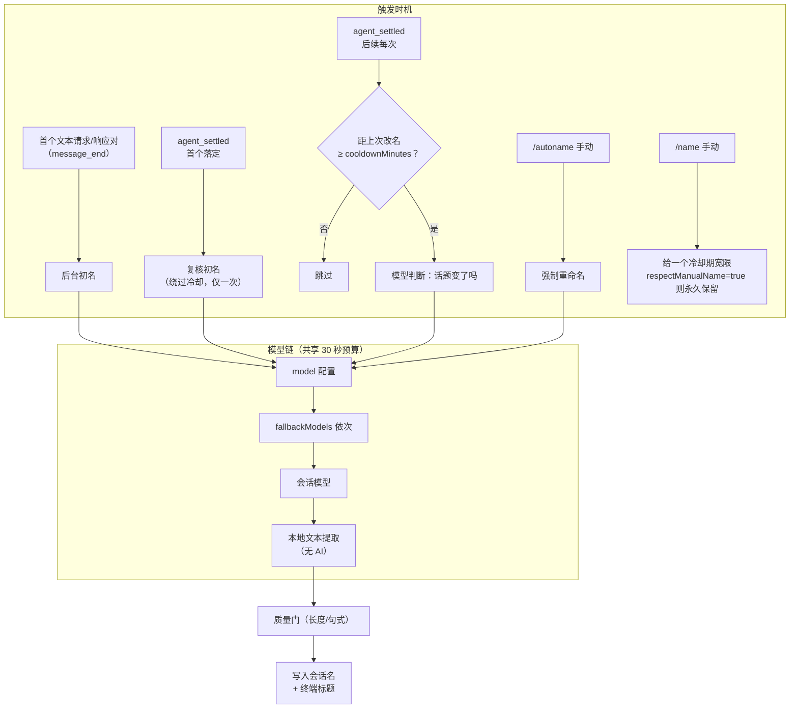

# pi-autoname 机制讨论

## 对照你的三点设想

| 设想 | 现状 | 判断 |
|---|---|---|
| ① 简洁拓展、重命名会话 | 纯拓展，`pi install` 即用 | ✅ 满足 |
| ② 不指定模型，只用主模型 | 默认就用会话模型；但多出 `model`/`fallbackModels` 两个配置 | ⚠️ 可精简，见下 |
| ③ 命令最小化 | 仅 1 个自有命令 `/autoname` | ✅ 满足 |

## 关于第②点的建议

**保留现状（可选模型配置）更好**，理由是成本其实很低：

- 不配置时行为就是「只用主模型」，零配置目标已达成——README 第一句就是 "Works out of the box"
- `model`/`fallbackModels` 只影响命名这一件事，风险低；命名模型跑挂了也只是退回文本提取，不伤主任务
- 命名是高频小请求，有人愿意用便宜小模型跑（如 MiniMax 而非主推理模型），砍掉这条通道等于逼他们换会话模型或放弃省钱

**折中方案**：如果觉得「多一个配置文件麻烦」是痛点，可以不删字段，而是弱化文档上的存在感——README 配置节把 `model`/`fallbackModels` 折叠进「高级：模型 fallback 链」小节，主线叙事只讲「什么都不配就行」。机制不变，认知负担降下来。

## 命令清单（第③点）

- `/autoname` — 唯一自有命令：从当前上下文强制重命名
- `/name` — Pi 内置命令，不是本拓展注册的；本拓展只是**观察**它产生的名字并给宽限期
- `/reload` — 改配置后生效（`titleSpinner`、`enabled` 等需重载）

命令面已经最小：自有命令只有 `/autoname` 一个。配置文件本身也是首次使用自动生成的，用户可以一辈子不看它。
